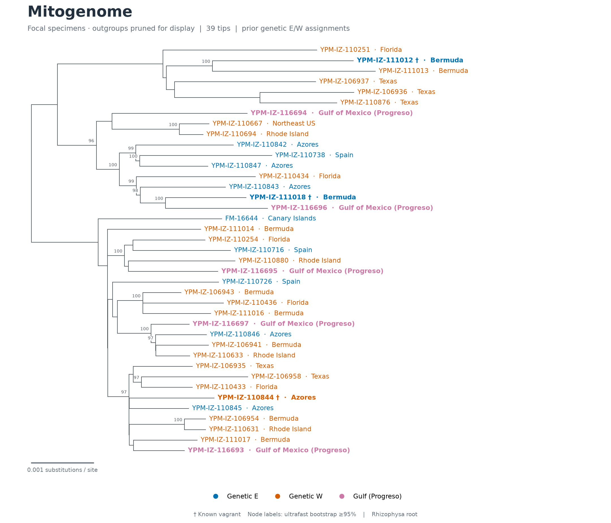

# Mexican Physalia phylogenetics using previously published datasets

Illumina read QC, mitochondrial annotation, and marker/mitogenome phylogenies
for five Mexican specimens alongside published Physalia sequences.

The five new specimens are **YPM-IZ-116693–116697**. The Illumina workflow and bundled QC outputs cover only these five specimens.
The trees use NCBI reference sequences for 35 P. physalis specimens in the
nuclear panels and 34 in mitochondrial panels, the five Mexican specimens,
six P. utriculus comparators, and available Rhizophysa outgroups. COI and 16S also include the Caribbean Sanger specimen CH887.
There is one sequence per specimen per analysis and one retained tree analysis
per marker; the full and focal figures are views of that same tree.



## Explore the results

| Tree | Full tree with references/outgroups | Focal view |
|---|---|---|
|16S|[PDF](analyses/results/genetic_groups/16S.pdf)|[PDF](analyses/results/genetic_groups/16S.focal.pdf)|
|18S|[PDF](analyses/results/genetic_groups/18S.pdf)|[PDF](analyses/results/genetic_groups/18S.focal.pdf)|
|COI|[PDF](analyses/results/genetic_groups/CO1.pdf)|[PDF](analyses/results/genetic_groups/CO1.focal.pdf)|
|ITS|[PDF](analyses/results/genetic_groups/ITS.pdf)|[PDF](analyses/results/genetic_groups/ITS.focal.pdf)|
|Mitogenome|[PDF](analyses/results/genetic_groups/mitogenome_submitted.pdf)|[PDF](analyses/results/genetic_groups/mitogenome_submitted.focal.pdf)|

PNG and editable SVG versions are alongside each PDF. E/W colors represent
**prior genome-wide genetic assignments**, not classifications inferred from
these trees. A dagger marks the three known vagrants; Mexican specimens are
pink and labeled **Gulf of Mexico (Progreso)**. CH887 is labeled
**Caribbean Sea (Puerto Morelos)** and shown in purple, without an E/W assignment. Internal-node labels show ultrafast-bootstrap support percentages only for branches with support ≥95%; all branches remain visible. All original support values remain in the Newick files.

ITS lacks a Rhizophysa sequence in the reference panel and is midpoint-rooted
for display. YPM-IZ-110972 is excluded from mitochondrial, COI and 16S analyses because no
mitogenome was deposited for it in the selected accession set. It remains in
18S and ITS. All five datasets are aligned de novo from NCBI records and local
sequences; no alignment backbone is used.
Focal views only prune comparison/outgroup taxa for display; they do not rerun
inference or change the retained subtree's branch lengths.

## Repository layout

| Directory | Contents |
|---|---|
|[illumina-preparation-qc-mitogenome-assembly](illumina-preparation-qc-mitogenome-assembly/)|Five-specimen Mexican workflow, manifests, environment records, compact QC reports, sharkmer products, and mitochondrial assemblies|
|[mitogenome-annotation](mitogenome-annotation/)|Five Mexican assemblies, original MITOS2 FASTA/GFF3/gene-order annotations, and a summary|
|[analyses](analyses/)|Selected sequences, alignments, IQ-TREE outputs, genetic-group annotations, figures, and public-sequence audit|
|[references/ncbi](references/ncbi/)|Versioned GenBank records, accession manifest, extraction rules and download provenance|
|[sanger-2026-10-14](sanger-2026-10-14/)|Original chromatograms, trace QC and processed CH887 sequences; combined trees are in analyses|
|[provenance](provenance/)|Historical execution settings, tool/environment records, input identities, and artifact checksums|

The Illumina manifests and outputs contain only the five Mexican specimens.
Their results were selected from the completed 40-specimen run without rerunning
assembly. Historical execution records retain their original scope; the complete
pre-cleanup snapshot is preserved outside this repository, as recorded in
[selection provenance](provenance/mexico-only-qc.json).

This is a curated snapshot of the completed analyses. Raw reads, large screening
reports, reference databases, software environments, job working directories,
and superseded exploratory tree runs are not bundled. The separate
Super-waster project is outside this repository.

## Recreate the figures

```bash
conda env create -f environment.yml
conda activate physalia-trees
snakemake --snakefile analyses/plots.smk --cores 2 --forceall
python scripts/validate_release.py
```

All files needed for plotting are included; raw-read storage and MITOS references
are not needed. The environment recipe is supplied; a clean environment rebuild
has not been tested. The figures were checked with the recorded existing Python,
Biopython and matplotlib environment.

For full inference, see [analysis methods](analyses/README.md). For QC, see
[the QC workflow](illumina-preparation-qc-mitogenome-assembly/README.md); full raw-read reruns require access
to the FASTQs and installation/configuration of the site-specific tools and
reference databases. Historical absolute paths in manifests/provenance identify
what was used; update execution configs when running elsewhere.

## Data availability and interpretation

The [reference audit](analyses/results/README.md) verifies all reference
sequences against their versioned GenBank records and voucher/isolate metadata.
[The accession manifest](references/ncbi/accessions.tsv) identifies the selected
34 mitochondrial and 35 nuclear P. physalis references, six P. utriculus
comparators, and Rhizophysa outgroups. Sequence identity does not by itself
establish specimen identity. Local mitochondrial annotations remain automated
and have not been manually curated to establish genome completeness.

E/W and vagrant labels are retained prior genome-wide assignments, with explicit
attribution in [analysis methods](analyses/README.md#display-metadata-and-interpretation).
They are separate from the NCBI sequence inputs. The new specimens remain
unassigned. [Rerun provenance](provenance/ncbi-rerun.json) records the historical
snapshot and fresh NCBI-based analysis.


## Caribbean Sanger specimen

The [CH887 Sanger analysis](sanger-2026-10-14/README.md) adds COI and 16S from one
Caribbean Sea specimen, with raw chromatograms, quality reports and reproducible
sequence processing. The two amplicons initially supplied as COI were identified
as different mitochondrial markers. CH887 is shown separately from genetic E/W.
The single COI and 16S trees linked above include CH887, the published reference
panels and all five Mexican specimens. Superseded WGS-only COI/16S results were
archived outside this repository; [consolidation provenance](provenance/tree-consolidation.json)
records the earlier consolidation; the current NCBI-based rerun supersedes those trees.

## Validation

With the analysis environment activated, run from the repository root:

```bash
python -m pytest -q
ruff check analyses/scripts illumina-preparation-qc-mitogenome-assembly/scripts sanger-2026-10-14/scripts
python scripts/validate_release.py
python sanger-2026-10-14/scripts/validate_sanger.py
```

The repository tracks README.md documentation, workflow code, selected scientific
inputs and results, environment recipes, and provenance. Other Markdown files,
local configuration, caches, bulk read files, temporary files, scheduler output,
and dry-run transcripts are excluded. Full execution requires the site resources
described in each workflow README.
