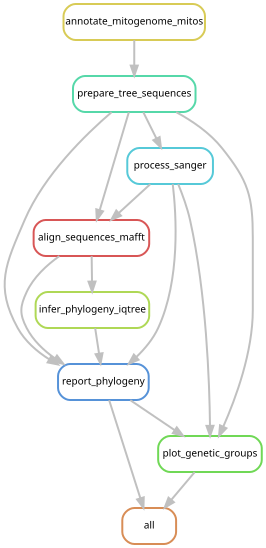

# Mexican Physalia with NCBI reference sequences

All five analyses use versioned NCBI GenBank records selected by accession and
voucher/isolate, the five retained Progreso specimens, and CH887 for COI/16S.
Every alignment is generated de novo. No pre-existing alignment backbone or
external repository sequence panel is used.

| Analysis | P. physalis references | Progreso | P. utriculus | Rhizophysa records | CH887 | Total |
|---|---:|---:|---:|---:|---:|---:|
|16S|34|5|6|11|1|57|
|18S|35|5|6|2|0|48|
|COI|34|5|6|8|1|54|
|ITS|35|5|6|0|0|46|
|Mitogenome|34|5|6|3|0|48|

The [accession manifest](../references/ncbi/accessions.tsv) contains all reference
identities and extraction modes. [Reference documentation](../references/ncbi/README.md)
describes the 140 distinct downloaded records and source-response checksums.
COI/16S are extracted from annotated mitochondrial features when a whole
mitogenome is the source; nuclear and stand-alone marker records are used whole.
YPM-IZ-110972 remains in 18S/ITS only. Redundant RefSeq copies NC_080941.1 and
NC_080942.1 are omitted in favor of OQ957199.1 and OQ957206.1.

## Local sequences and inference

For Mexican COI/16S, select the longest individual MITOS cox1/rrnL fragment or
canonical sharkmer product, with MITOS winning ties. 18S/ITS use the longest
canonical sharkmer product. Fragmented gene annotations are not concatenated.
MITOS2 supplied COI/16S for all five specimens; sharkmer supplied 18S/ITS.
`inputs/*.candidates.tsv` records the selection. These sequences and the CH887
consensuses are unchanged from the preceding analysis.
MITOS2 2.1.9 used `refseq89m`, code 4 and
`--linear --orih 0 --oril 0 --trna 0 --intron 0`.

MAFFT 7.526 uses `--auto --adjustdirectionaccurately` on each complete, unaligned
panel, including mitogenomes. Validation normalizes MAFFT direction prefixes,
checks unique IDs, exact tip membership and the nucleotide/IUPAC alphabet,
and removes columns containing only `-` or `?`.
IQ-TREE 3.0.1 uses ModelFinder (`-m MFP`) with the Bayesian information criterion,
1,000 ultrafast bootstraps per search (`-B 1000`) and base seed 20261012.
18S and ITS use five searches; COI, 16S and mitogenomes were extended to ten
because their initial five searches did not repeat the best likelihood.
`search_runs_by_marker` records these settings. IQ-TREE increments the seed
by 1000 for successive searches.
The four markers and mitogenomes are separate nucleotide analyses; no codon
partitioning or marker concatenation is applied.

## Display metadata and interpretation

Figures display rooted bootstrap consensus trees (`.contree`), not the separate
best maximum-likelihood trees (`.treefile`). Non-ITS trees are rooted on the
Rhizophysa split when monophyletic; ITS is midpoint-rooted. Actual rooting and
selected models are recorded in `results/tree_reports/*.json`. Full and focal
figures show the same inference; pruning comparator/outgroup tips for the focal
view preserves the remaining topology and branch lengths. Internal-node labels
show ultrafast-bootstrap support percentages only for branches with support ≥95%; all branches remain visible. Exact values remain in Newick files.

E/W colors and vagrant labels are **prior genome-wide assignments**, retained at
the author's request. They come from the frozen whole-assembly NGSadmix K2
analysis documented in `provenance/genetic_groups/` and
`inputs/genetic_annotations.tsv`; they are not inferred from GenBank records or
these new trees. Church et al. (2025), DOI
[10.1016/j.cub.2025.05.066](https://doi.org/10.1016/j.cub.2025.05.066), supplies
published population-genomic context. The five Progreso specimens and CH887
remain unassigned for E/W. Mitochondrial placement does not establish genome-wide
ancestry, and nearest-reference distances do not alone confirm species identity.

The previous trees and availability reports are preserved in a historical local
snapshot and the previous Git revision, identified by
[rerun provenance](../provenance/ncbi-rerun.json). Their support values do not
describe the new trees. No assembly, trace processing or annotation was rerun.

## Retained result summary

| Dataset | Aligned sites | Model | Searches | P. physalis reference-clade support |
|---|---:|---|---:|---:|
| COI | 1,569 | TPM2u+F+G4 | 10 | 43% |
| 16S | 2,091 | TPM2u+F+G4 | 10 | 37% |
| 18S | 1,791 | HKY+F | 5 | Not recorded |
| ITS | 877 | F81+I | 5 | 76% |
| Mitogenome | 16,119 | TPM3u+F+I+R3 | 10 | 89% |

All new tips fall within the corresponding *P. physalis* reference clade,
consistent with that identification. CH887's immediate groupings have 23% COI
and 63% 16S support. These values describe particular branches, not probabilities
of species identity. Partial markers, near-zero branches and weak groupings limit
within-species resolution. Missing support is not interpreted as zero.

`results/ncbi_run_summary.json` records every search likelihood and local grouping.
16S and mitogenome searches retain small likelihood differences after expansion
to ten runs; optimization convergence is not asserted. No empty alignment columns
were removed. No genome-wide ancestry assignments were made for the new specimens.

## Reproduce

From the repository root, with the environment from `environment.yml` and
MAFFT 7.526 / IQ-TREE 3.0.1 available:

```bash
python analyses/scripts/download_references.py
snakemake all --snakefile analyses/Snakefile --cores 16 --dry-run
snakemake all --snakefile analyses/Snakefile --cores 16
python analyses/scripts/audit_availability.py
snakemake --snakefile analyses/plots.smk --cores 2 --forceall
python scripts/validate_release.py
```

The download step verifies and reuses the bundled NCBI snapshot. This tree
workflow consumes retained Mexican annotations/assemblies and Sanger consensuses;
it does not need raw Illumina reads, MITOS databases, or the previous reference
repository. Raw-read and annotation reproduction have their own documented paths.

For the existing cluster installation, `sbatch analyses/batch.sh` captures source,
versions, commands and execution status under `provenance/slurm-<job>/` before
running the same workflow. Its site-specific paths must be adapted elsewhere.



Generate the rule graph using `analyses/scripts/update_rulegraph.sh`.
[Reference audit](results/README.md) lists accession/feature-level verification.
