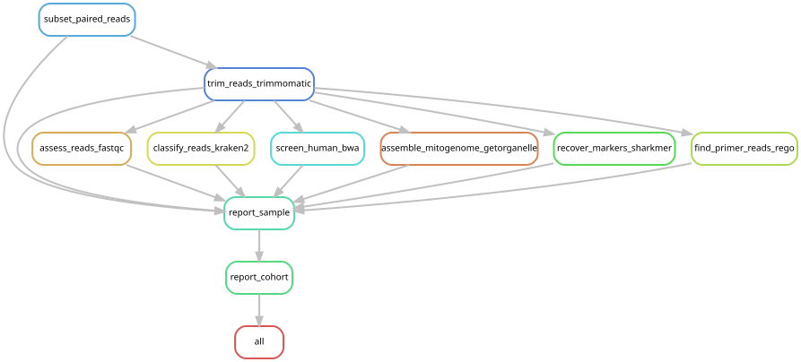

# Physalia Illumina preparation, QC and mitogenome assembly

Read preparation, quality control, marker recovery and mitochondrial genome
assembly for **five Mexican specimens**,
`YPM-IZ-116693` through `YPM-IZ-116697`, collected at Gulf of Mexico (Progreso).
See the [sample manifest](metadata/samples.tsv) and [exact read paths](metadata/reads.tsv).
Published specimens enter the downstream trees through the pinned reference
sequences, independently of this QC workflow.

The workflow uses up to **10 million read pairs per specimen**, taking the
beginning of each input rather than a random subsample. Each specimen has one
paired sequencing unit. Short inputs contribute fewer pairs, which are reported.
The retained outputs are the verified Mexican subset of the completed October
run; no assembly was rerun for this selection. See
[selection provenance](../provenance/mexico-only-qc.json).

Trimmomatic removes adapters and trims low-quality bases. FastQC assesses the
trimmed reads, Kraken2 classifies them, and BWA screens for human reads. These
screens do not filter the reads supplied to assembly. GetOrganelle attempts an
animal mitochondrial assembly; sharkmer recovers cnidarian, metazoan, and bacterial
primer products. A
recovered assembly path is not, by itself, evidence of a complete mitogenome.

GetOrganelle consumes paired trimmed reads. sharkmer v0.2.0 consumes the
trimmed forward reads with `-k 31 -n 100` and the `cnidaria`, `metazoa`, and
`bacteria` primer panels.

## Storage

- This repository holds code, configuration, metadata, and compact final results.
- `/vast/palmer/scratch/dunn/dd2233/physalia-illumina-qc/` holds execution files,
  subsets, trimmed reads, and assembly working files. Original FASTQs stay in YCGA
  storage and are read in place. Shared databases are also referenced in place.
- `results/cohort-2026-10-09/<sample>/` retains marker and mitochondrial FASTAs,
  sequence lengths, QC report, checksums, and a JSON summary. Larger report evidence
  remains on PI storage but is excluded from git.
- `results/cohort-2026-10-09/sample_summary.tsv` contains the five Mexican reports.
  `python scripts/status.py` lists every specimen even when a run is incomplete.
- `provenance/slurm-<job>/` preserves run logs, source archive, environment and
  reference identities. It remains on PI storage outside git.

Scratch has a 60-day purge policy; retain outputs in `results/` before relying on
them. Preserve run provenance with any later publication deposit.

## Environment and inputs

This workflow runs on McCleary against existing YCGA inputs. Use the existing
`IlluminaQC` conda environment and the exact module versions in
[`scripts/environment.sh`](scripts/environment.sh):

```bash
cd illumina-preparation-qc-mitogenome-assembly
source scripts/environment.sh
python scripts/preflight.py --output provenance/preflight.json
```

The environment includes Snakemake 9.14.5, Python 3.12.12, Biopython 1.86, and
GetOrganelle 1.7.7.1. Sharkmer 0.2.0 is a configured local tool.
The conda explicit specification in `env/illuminaqc-linux-64.explicit.txt` can
recreate the conda packages with `conda create -p <new-prefix> --file <specification>`;
it does not install the module tools, sharkmer, or reference databases.
The historical package request is also retained in `env/illuminaqc-history.yaml`.
Paths are configurable in `config/config.yaml`. Access to the original YCGA
FASTQs and shared reference databases is required; they are not distributed here.

The exact nine-sequence mitochondrial seed FASTA is bundled separately in
[`../references/mitochondrial-seed/`](../references/mitochondrial-seed/), with
its original headers, sequence inventory, and execution-matching checksum.
For a rerun, set `mito_seed` to the absolute path of that bundled file.
This seed is supplied to GetOrganelle with `-s`; the GetOrganelle database
configured through `getorganelle_db` remains a separate external dependency.
Its animal mitochondrial LabelDatabase and SeedDatabase report version 0.0.1.
The Kraken2 site alias resolves to `k2_standard_20240904`. Human screening
used GRCh38 primary-assembly and mitochondrial sequences (GCA_000001405.15),
with an additional EBV decoy (AJ507799.2).
The [reference audit](../provenance/reference-audit/README.md) records the
supporting checksums, source metadata, and limits of release-date verification.

The prefix preflight is a quick check. Every read pair actually selected is
validated during the run, and selected uncompressed input prefixes are hashed.
The unread tails of original FASTQs are not validated or hashed.

## Run

Preview the full workflow and the pilot from the repository root:

```bash
snakemake all --snakefile Snakefile --configfile config/config.yaml --cores 32 --dry-run
snakemake pilot --snakefile Snakefile --configfile config/config.yaml --cores 32 --dry-run
```

Submit the analysis:

```bash
sbatch batch.sh
```

The allocation has 32 CPUs, 256 GB RAM and 48 hours on `ycga`. It first executes
the full workflow for `YPM-IZ-116693`. The cohort
continues only after this specimen has validated retained reports. The remaining
specimens run in groups of four to bound temporary storage. Scientific settings
are the same for pilot and full execution. Tool errors stop the affected path;
independent specimens can continue. No-path assembly outcomes remain explicit.

The launcher uses the scratch run directory as Snakemake's working directory.
Rerunning it resumes the same analysis using Snakemake's dependency records.
Use a new `run_id` for a new scientific configuration. Source and config must be
committed before submission, so the saved source archive identifies what ran.



Generated from `Snakefile`, `config/config.yaml`, target `all` with
`scripts/update_rulegraph.sh`. The graph collapses repeated per-specimen jobs.

See [repository validation instructions](../README.md#validation).

This directory is the five-specimen selection from the historical QC run. Full reruns require
site-specific configuration of scratch, FASTQ and database paths. Compact
outputs are included, but the original checksums also reference omitted screening
evidence; use the top-level release validator for included files.

The unused rego primer-read retrieval branch and its report sections were removed
from the maintained workflow. It supplied no downstream marker or tree inputs.
Historical execution configs, tool hashes and original per-specimen checksum
manifests retain the record of that run. The five displayed QC reports omit only
the rego section; [removal provenance](../provenance/rego-removal.json) records
the original and revised hashes. Use the current release manifest for these
reports; historical checksum manifests describe their original versions.
