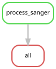

# Caribbean CH887: Sanger COI and 16S

One Caribbean Sea (Puerto Morelos) specimen, provisionally named **CH887**, is represented by two
amplicons. The user confirmed that the two file prefixes refer to the same specimen:
`CH887-D01` is COI (called `CO1` in the existing pipeline), and `CH887A-D01` is 16S.
The voucher ID, precise collection coordinates, and experimental PCR primer identities were
not supplied. The specimen is **unassigned for genetic E/W** and shown in purple.
This addition does not infer genome-wide ancestry from mitochondrial markers.

COI and 16S now have one combined analysis each in `../analyses/results`,
including CH887, the published references, all five Gulf of Mexico (Progreso)
specimens, six utriculus comparators and Rhizophysa outgroups. There are 57 COI
tips and 60 16S tips. This folder contains the chromatograms and processing evidence;
it does not contain a second set of tree results.

## Combined trees

| Marker | Full tree | Focal view of the same tree |
|---|---|---|
| COI | [PDF](../analyses/results/genetic_groups/CO1.pdf) | [PDF](../analyses/results/genetic_groups/CO1.focal.pdf) |
| 16S | [PDF](../analyses/results/genetic_groups/16S.pdf) | [PDF](../analyses/results/genetic_groups/16S.focal.pdf) |

PNG and editable SVG versions are alongside the PDFs. Figures show the bootstrap
consensus; nearest-tip reports use the ML tree and can differ in poorly resolved
regions. Partial markers do not resolve all relationships among specimens.

## Processed sequences

| Marker | Retained length | Uncertain bases | Evidence |
|---|---:|---:|---|
| COI | 622 bp | 3 N | Forward read; reverse excluded |
| 16S | 553 bp | 0 | Agreeing forward/reverse overlap |

The retained COI sequence has a stop-free frame under mitochondrial code 4.
The 16S overlap exactly matches multiple published Physalia sequences, so sequence
identity alone cannot distinguish those specimens.

[Quality overview](results/qc/quality_overview.png) ·
[Representative trace windows](results/qc/trace_review.png)

## Files and interpretation

- `raw/`: all eight original AB1 and SEQ files, unchanged. AB1 contains the
  fluorescence chromatogram and base-call quality scores; SEQ is plain base-call
  text. Each SEQ is checked against the corresponding AB1 calls.
- `config/samples.tsv`: one specimen, two marker amplicons, provenance of names.
- `results/qc/`: quality overview, full chromatogram PDFs, trimmed FASTQ files,
  per-base consensus evidence, sequence summaries and marker/reference matches.
- `inputs/*.sanger.fasta`: the new sequences alone. Combined FASTAs and tip
  metadata are in `../analyses/inputs/combined/`.
- `../analyses/results/`: the single set of combined alignments, IQ-TREE results
  and figures; full and focal plots share the same inference.

The COI reverse trace fails quality control; COI is a **single-forward-read sequence**,
not a bidirectionally verified consensus. Its ambiguous calls remain N. The 16S
consensus uses only the region covered by both quality-trimmed strands, after
reverse-complementing the reverse read. The high-quality overlap agrees; five
low-quality forward-only insertion calls are excluded using the opposing strand.
A good consensus does not by itself establish specimen identity or exclude a
mixed-template PCR product. Read the chromatograms alongside the summaries.

## Processing rules

1. Select the maximum-scoring contiguous interval using score
   `0.01 - 10^(-Phred/10)` per base (a Q20 error-probability threshold).
   This is a documented Mott-style implementation, rather than Biopython's
   `abi-trim` default cutoff of 0.05. Reads shorter than 100 bp after trimming
   cannot contribute to the consensus.
2. Mask single-strand calls below Q20 to N. No reference sequence fills uncertain
   bases. Local forward/reverse alignment uses match +2, mismatch −3, gap opening
   −6 and extension −1, and requires at least 300 identical bases.
3. Within overlap, accept agreeing bases if either is Q20; use the Q20 base when
   the other is low quality; preserve conflicting Q20 calls as IUPAC ambiguity.
   Exclude an insertion only if its sole supporting call is below Q20 and both
   flanking calls on the opposing strand are Q20. Other indel conflicts stop the
   workflow for review. Uncovered ends are not added to the 16S consensus.
4. The COI forward read contains an exact terminal reverse-complement match to
   the published **HCO2198** primer sequence. Exclude that motif and everything
   after it. This is a precaution based on the sequence, not confirmation of which
   primers the experiment used. No other primer removal is asserted.
5. Compare the resulting sequences with the existing COI, 16S, 18S and ITS panels
   to verify marker identity. COI translation is checked in all three forward
   frames using mitochondrial code 4, with ambiguous codons retained as X.
6. Re-align each expanded marker panel with MAFFT 7.526 `--auto
   --adjustdirectionaccurately`; validate IDs, alphabet and all-gap columns.
   Infer with IQ-TREE 3.0.1, ModelFinder/BIC, 1,000 ultrafast bootstraps, five searches
   and seed 20261012, matching the original inference settings. Validate ML and
   consensus tip sets and root the displayed consensus on the Rhizophysa split.

Biopython's [ABI format documentation](https://biopython.org/docs/1.80/api/Bio.SeqIO.AbiIO.html)
describes the trace parser. The HCO2198 motif is listed in the original research
primer table in [this published primer table](https://pmc.ncbi.nlm.nih.gov/articles/PMC9848487/)
(attributed there to Folmer et al.). The file names indicate M13 sequencing primers;
that does not establish the gene-specific PCR primers.

## Reproduce

From the repository root, activate the `physalia-trees` environment defined in
`environment.yml`, with `mafft` and `iqtree3` available:

```bash
snakemake all --snakefile sanger-2026-10-14/Snakefile --cores 8 --dry-run
snakemake all --snakefile sanger-2026-10-14/Snakefile --cores 8  # trace QC and combined inputs
snakemake all --snakefile analyses/Snakefile --cores 24  # all five trees
```

On this cluster, `sbatch sanger-2026-10-14/batch.sh` runs trace QC and input preparation.
Tree inference uses the shared `analyses/Snakefile`; plotting alone uses
`snakemake --snakefile analyses/plots.smk --cores 2 --forceall`. It records environment,
source changes and tool versions alongside its workflow log. All originals are
preserved; `provenance/raw_checksums.tsv` records their identities. Existing analysis
artifacts remain covered by the repository's release validator.

Tests: `python -m pytest -q sanger-2026-10-14/tests`. The synthetic checks cover
end trimming, preservation of conflicting high-quality calls, and conservative
handling of low-quality insertion calls.



For additional visual review, run `python sanger-2026-10-14/scripts/review_trace_windows.py`.
Validate the completed addition with `python sanger-2026-10-14/scripts/validate_sanger.py`.
The cluster execution uses the existing plotting Python (Biopython 1.85, NumPy 2.3.5,
matplotlib 3.11.1); package versions are frozen in the Slurm provenance.

Locality labels were clarified by the user: YPM-IZ-116693–116697 are
**Gulf of Mexico (Progreso)** and CH887 is **Caribbean Sea (Puerto Morelos)**.
The reproducible label overrides are in `config/localities.tsv`. These are
collection localities; genetic-group assignments are unchanged.
